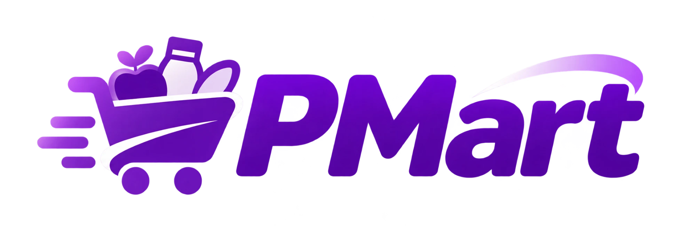
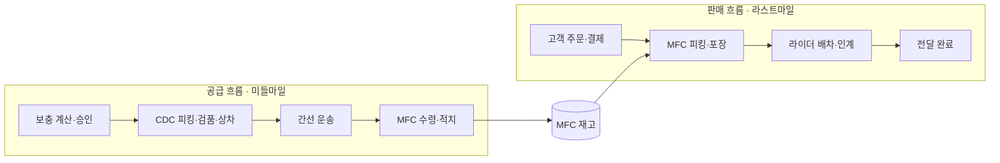
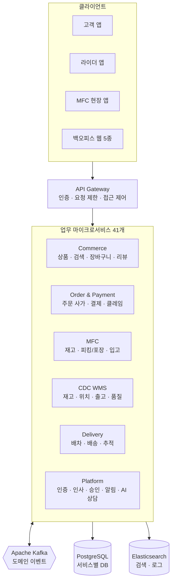

[동성인재개발교육원](https://www.dshrd.or.kr/) 
교과과정: [클라우드 AI기반 마이크로서비스 풀스택(리액트/자바) 개발](https://www.work24.go.kr/hr/a/a/3100/selectTracseDetl.do?tracseId=AIG20250000501497&tracseTme=2&cstmConsTme=&crseTracseSe=C0061&trainstCstmrId=&tracseReqstsCd=&focusId=)

 

# PMart

**도심 소형 풀필먼트 센터(MFC) 기반 퀵 커머스 플랫폼**

장보기 주문부터 물류센터 재고, 센터 보충, 피킹·포장, 라이더 배달, 취소·반품까지 이어지는 과정을 마이크로서비스로 나눠 만든 팀 프로젝트

 

 

**[팀원 · 담당 보기](https://github.com/code-and-pick/.github/blob/main/profile/TEAM.md)** &nbsp;|&nbsp; **개발 기간** 2026.10.23 ~ 진행 중

---

## 프로젝트 소개

고객이 앱에서 장을 보면, 배송지를 맡은 도심 MFC에 실제로 있는 재고로 주문을 받습니다. MFC에서 상품을 골라 포장하면 라이더가 바로, 또는 고객이 고른 시간에 가져다줍니다.

주문 화면만이 아니라 그 뒤의 물류도 함께 만들었습니다. 크게 두 흐름이 있습니다.

- 판매 흐름(라스트마일): 검색·장바구니 → 주문·결제 → MFC 피킹·포장 → 라이더 배차·인계 → 배달 완료 → 리뷰·취소·반품
- 공급 흐름(미들마일): MFC 보충 요청 → 보충 수량 계산·승인 → 중앙 물류센터(CDC) 피킹·상차 → 간선 운송 → MFC 입고

두 흐름은 MFC 재고에서 만납니다. 입고되면 재고가 늘고, 주문이 들어오면 재고를 잡아 두었다가 라이더에게 넘기는 순간 빠집니다.

<!-- [사진 자리 2] 시연 영상 — 링크가 생기면 아래 줄의 주석을 풀고 주소를 바꾼다 -->
<!-- ▶ **시연 영상**: https://youtu.be/영상주소 -->

## 시스템 구성

## 앱 구성

| 앱 | 쓰는 사람 | 위치 |
|---|---|---|
| **고객 앱** | 고객 | [pmart-clients / apps/customer_app](https://github.com/code-and-pick/pmart-clients/tree/main/apps/customer_app) |
| **라이더 앱** | 라이더 | [pmart-clients / apps/rider_app](https://github.com/code-and-pick/pmart-clients/tree/main/apps/rider_app) · 시뮬레이터 [pmart-rider-simulation](https://github.com/code-and-pick/pmart-rider-simulation) |
| **MFC 앱** | MFC 작업자 | [pmart-clients / apps/mfc_app](https://github.com/code-and-pick/pmart-clients/tree/main/apps/mfc_app) · 시뮬레이터 [pmart-mfc-simulation](https://github.com/code-and-pick/pmart-mfc-simulation) |
| **DC 앱** | 중앙 물류센터(CDC) 운영자 | 백오피스 웹 [pmart-clients / web/cdc-backoffice](https://github.com/code-and-pick/pmart-clients/tree/main/web/cdc-backoffice) · 시뮬레이터 [pmart-cdc-simulation](https://github.com/code-and-pick/pmart-cdc-simulation) |
| **백오피스 앱** (웹 5종) | 본사·센터 운영자 | 통합 [backoffice](https://github.com/code-and-pick/pmart-clients/tree/main/web/backoffice) · [MFC](https://github.com/code-and-pick/pmart-clients/tree/main/web/mfc-backoffice) · [CDC](https://github.com/code-and-pick/pmart-clients/tree/main/web/cdc-backoffice) · [라이더 운영](https://github.com/code-and-pick/pmart-clients/tree/main/web/rider-backoffice) · [인사](https://github.com/code-and-pick/pmart-clients/tree/main/web/hr-backoffice) |

앱은 모두 [pmart-clients](https://github.com/code-and-pick/pmart-clients) 한 저장소에 있고 공통 코드를 같이 씁니다. 백엔드는 [pmart-backend](https://github.com/code-and-pick/pmart-backend) 하나를 함께 씁니다.

## 주요 기능

**고객 앱** (Flutter, Android)
- Google·카카오·네이버 계정으로 로그인
- 홈 기획전·랭킹, 카테고리, 검색(초성·오타도 찾아 줌, 비슷한 뜻의 상품까지)
- 장바구니와 쿠폰, 토스페이먼츠 결제
- 주문·배송 상황 보기, 리뷰 쓰기
- 궁금한 점은 AI 상담에게 물어보기

**라이더 앱** (Flutter, Android)
- 출근하고 배차 받기
- MFC에서 QR로 상품 넘겨받기
- 길 안내, 배달 완료 사진 남기기
- 정산 내역 보기

**MFC 앱** (Flutter, PDA)
- 주문 상품 피킹·포장, 라이더에게 인계
- 입고 상품 받아서 자리에 넣기
- 재고 실사

**DC 앱** (React 웹 + 시뮬레이터)
- 중앙 물류센터 입고·적치·보충
- 출고 작업과 재고·품질 관리

**백오피스 앱** (React 웹 5종)
- 통합: 주문·고객·상품·승인·문의·대시보드
- MFC·CDC·라이더 운영·인사는 각자 웹이 따로 있고, 한 번 로그인하면 오갈 수 있음

<!-- [사진 자리 3] 앱 화면 — profile/images/ 에 올린 뒤 이 블록의 주석(맨 위·맨 아래 두 줄)을 푼다

<b>화면 미리보기</b>

**고객 앱**

   

**라이더 앱**

  

**MFC 현장 앱**

 

**백오피스 웹**

 

-->

## 기술적으로 신경 쓴 부분

- 주문·취소처럼 여러 서비스를 거치는 일은 사가(오케스트레이션)로 처리했습니다. 중간에 실패하면 앞 단계를 되돌립니다.
- 데이터를 바꿀 때 이벤트도 같은 트랜잭션에 남기고(Outbox), Debezium이 Kafka로 보냅니다. 받는 쪽은 같은 이벤트가 두 번 와도 한 번만 처리합니다.
- API는 OpenAPI, 이벤트는 JSON Schema로 먼저 정하고 코드를 거기서 만들었습니다.
- 라이더 배차와 MFC 작업 배정은 Google OR-Tools로 계산합니다.
- 상품 검색은 Elasticsearch에 의미 검색을 더했고, AI 상담은 로컬 LLM(Ollama)으로 RAG를 돌립니다.
- 고객·라이더·직원 로그인을 따로 두었고, 직원이 고객 개인정보를 열어 볼 때는 기록이 남습니다.
- 로그·지표·추적을 모든 서비스에 똑같이 붙여서 한 곳에서 봅니다.
- PC 5대에 서비스를 나눠 띄우고(Kafka 3대 묶음 포함) 실제 휴대폰으로 시험합니다.

## 숫자로 보기

| 항목 | 규모 |
|---|---|
| Spring Boot 서비스 | 45개 (업무 41 · 플랫폼 4) |
| 이벤트 스키마 | 226개 (JSON Schema) |
| 아키텍처 결정 기록(ADR) | 89건 |
| 클라이언트 | 모바일 앱 3종 · 백오피스 웹 5종 |
| 현장 시뮬레이터 | MFC · CDC · 라이더 |

<!-- [사진 자리 4] 시뮬레이터 화면(선택) — 올린 뒤 이 블록의 주석을 푼다
 

-->

## 저장소

| 저장소 | 내용 |
|---|---|
| [pmart-backend](https://github.com/code-and-pick/pmart-backend) | Spring Boot 마이크로서비스 백엔드(Java 21, Gradle). 서비스, 공통 라이브러리, API·이벤트 계약, 설계 문서(ADR), 배포 스크립트 |
| [pmart-clients](https://github.com/code-and-pick/pmart-clients) | Flutter 모바일 앱(고객·라이더·MFC 현장)과 React 백오피스 웹 |
| [pmart-config](https://github.com/code-and-pick/pmart-config) | Spring Cloud Config 설정 저장소(서비스별 local·lan·prod) |
| [pmart-mfc-simulation](https://github.com/code-and-pick/pmart-mfc-simulation) | MFC 현장 시뮬레이터. 실제 센터가 없어서 피킹·포장·입고를 화면으로 대신 돌리고 백엔드와 연결 |
| [pmart-cdc-simulation](https://github.com/code-and-pick/pmart-cdc-simulation) | CDC(중앙 물류센터) 시뮬레이터 |
| [pmart-rider-simulation](https://github.com/code-and-pick/pmart-rider-simulation) | 라이더 배달 시뮬레이터 |

## 기술 스택

| 영역 | 기술 |
|---|---|
| 백엔드 | Java 21 · Spring Boot · Spring Cloud Gateway · Spring Cloud Config · Spring Cloud Stream · Spring Security (OAuth2/OIDC) |
| 데이터 | PostgreSQL · Flyway · Redis · Elasticsearch · pgvector |
| 메시징 | Apache Kafka (KRaft 3노드) · Debezium |
| 인증 | Keycloak · 소셜 로그인 (Google · 카카오 · 네이버) |
| 최적화 · AI | Google OR-Tools · Ollama (로컬 LLM · 임베딩) |
| 관측 | Micrometer · OpenTelemetry · Zipkin · Prometheus · Grafana · Elastic Stack |
| 클라이언트 | Flutter · React · Vite |
| 외부 연동 | 토스페이먼츠 · Firebase Cloud Messaging |
| 빌드 · 배포 | Gradle (Kotlin DSL) · Jib · Docker · Testcontainers |

## 협업 방식

- 업무 규칙을 먼저 정리하고, 서비스 경계와 API·이벤트 계약을 정한 다음 구현했습니다. 결정을 바꿀 때는 ADR로 남겼습니다.
- 플랫폼·백오피스·MFC·AI 상담·배송·CDC로 영역을 나눠 동시에 개발했습니다. 각 영역의 서비스·계약·화면은 맡은 사람이 고칩니다.
- 다른 영역에 필요한 API·이벤트·화면은 요청서로 보내고, 받는 쪽이 만들어서 회신합니다.
- 각자 포크에서 브랜치로 작업해 PR을 올리면, 플랫폼 담당이 검토해서 합치고 LAN에 배포합니다.
- 공용 시험 환경을 여럿이 같이 쓰기 때문에 배포는 한 곳에서만 합니다.
- 영역마다 작업 일지와 인수인계 문서를 남겨 다음 사람이 이어받을 수 있게 했습니다.

## 팀

팀원과 맡은 부분은 따로 정리했습니다. → **[팀원 · 담당 보기](https://github.com/code-and-pick/.github/blob/main/profile/TEAM.md)**

---

지도: 서성원 훈련 교사

