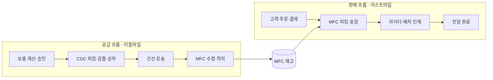
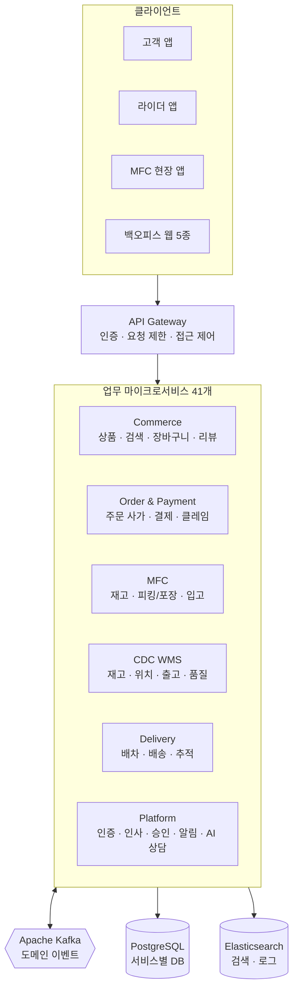

<!-- [사진 자리 1] 로고 — profile/images/logo.png 를 올린 뒤 아래 줄의 주석을 푼다 -->
<!--  -->

# PMart

**도심 소형 풀필먼트 센터(MFC) 기반 퀵 커머스 플랫폼**

주문부터 중앙 물류센터 재고·센터 보충·피킹·포장·라이더 배달·클레임까지, 하나의 흐름으로 설계하고 구현한 마이크로서비스 프로젝트

 

---

## 프로젝트 소개

PMart 는 고객이 앱에서 장을 보면 **배송지를 담당하는 도심 MFC 의 실제 재고**로 주문을 받고, MFC 가 피킹·포장한 상품을 **라이더가 즉시 또는 예약 시간에 배달**하는 퀵 커머스 서비스입니다.

판매 화면만 만드는 것이 아니라, 그 뒤에서 움직이는 **물류 전체**를 서비스 경계로 나눠 구현했습니다.

- **판매 흐름(라스트마일)** — 탐색·검색 → 장바구니 → 주문 초안·견적 → 재고 예약·배송 슬롯 확보 → 결제 승인 → MFC 피킹·포장 → 라이더 배차·인계 → 전달 완료 → 리뷰·클레임
- **공급 흐름(미들마일)** — MFC 보충 필요 → 보충 계산·배분·승인 → 중앙 물류센터(CDC) 피킹·검품·상차 → 간선 운송 → MFC 수령·검수·적치 → 운송 중 재고 대사

두 흐름은 **MFC 재고**에서 만납니다. 공급은 현물을 늘리고, 판매는 예약으로 점유했다가 라이더에게 인계하는 순간 현물과 예약을 함께 줄입니다.

<!-- [사진 자리 2] 시연 영상 — 링크가 생기면 아래 줄의 주석을 풀고 주소를 바꾼다 -->
<!-- ▶ **시연 영상**: https://youtu.be/영상주소 -->

## 시스템 구성

## 사용자별 화면

| 사용자 | 앱 | 하는 일 |
|---|---|---|
| 고객 | 고객 앱 (Flutter, Android) | 소셜 로그인(Google·카카오·네이버), 홈·카테고리·검색, 장바구니·쿠폰, 결제(토스페이먼츠), 주문·배송 조회, 리뷰, AI 상담 |
| 라이더 | 라이더 앱 (Flutter, Android) | 출근·배차 수락, 픽업 인계(QR), 길 안내·위치 공유, 전달 사진, 정산 |
| MFC 작업자 | MFC 현장 앱 (Flutter, PDA) | 피킹·포장·인계, 입고·적치, 재고 실사·정정 |
| 운영자 | 백오피스 웹 (React) | 통합 운영 · MFC · CDC · 라이더 운영 · 인사 — 주문·고객·상품·재고·승인·문의 관리 |

<!-- [사진 자리 3] 앱 화면 — profile/images/ 에 올린 뒤 이 블록의 주석(맨 위·맨 아래 두 줄)을 푼다

<b>화면 미리보기</b>

**고객 앱**

   

**라이더 앱**

  

**MFC 현장 앱**

 

**백오피스 웹**

 

-->

## 기술적 특징

- **사가 오케스트레이션 + 이벤트 전파** — 주문·취소·시간 변경처럼 여러 서비스에 걸친 거래는 오케스트레이터가 단계와 보상을 조정하고, 확정된 사실은 Kafka 이벤트로 퍼뜨립니다. 2PC 를 쓰지 않습니다.
- **Outbox + Debezium** — 업무 변경과 이벤트 저장을 한 트랜잭션에 두고, Debezium 이 Kafka 로 내보냅니다. 소비자는 Inbox 로 멱등하게 처리하고, 실패는 DLT 와 재처리 API 로 남깁니다.
- **계약 우선 개발** — REST 는 OpenAPI, 이벤트는 JSON Schema 가 정본입니다. 코드는 계약에서 생성하고, 발행 전에 스키마를 검증합니다.
- **최적화 엔진** — 라이더 배차와 MFC 작업 배정·피킹 순서는 Google OR-Tools(CP-SAT·Routing)로 추천합니다.
- **검색과 AI** — Elasticsearch 형태소·초성·동의어·오타 교정 검색에 벡터 의미 검색을 더했고, 상품·정책 질문은 RAG 기반 AI 상담이 답합니다(로컬 LLM, Ollama).
- **인증 분리** — 고객·라이더·직원마다 토큰 발급자를 나누고(직원은 Keycloak 기반 사내 계정), 게이트웨이에서 사용자 종류별 접근을 확인합니다. 개인정보 원문 열람은 감사 기록이 남은 뒤에만 보여 줍니다.
- **관측** — 로그(Elastic Stack)·지표(Prometheus·Grafana)·추적(OpenTelemetry·Zipkin)을 모든 서비스에 같은 방식으로 붙였습니다.
- **실제 환경 배포** — 5대의 PC 에 Kafka 3노드 클러스터와 서비스들을 나눠 배치하고, 사설 인증서로 HTTPS 를 구성해 실기기로 시험합니다.

## 숫자로 보기

| 항목 | 규모 |
|---|---|
| Spring Boot 서비스 | 45개 (업무 41 · 플랫폼 4) |
| 이벤트 스키마 | 226개 (JSON Schema) |
| 아키텍처 결정 기록(ADR) | 89건 |
| 클라이언트 | 모바일 앱 3종 · 백오피스 웹 5종 |
| 현장 시뮬레이터 | MFC · CDC · 라이더 |

<!-- [사진 자리 4] 시뮬레이터 화면(선택) — 올린 뒤 이 블록의 주석을 푼다
 

-->

## 저장소

| 저장소 | 내용 |
|---|---|
| [pmart-backend](https://github.com/code-and-pick/pmart-backend) | Spring Boot 마이크로서비스 백엔드 — Java 21, Gradle Multi-Project. 서비스·공통 라이브러리·API/이벤트 계약·설계 문서(ADR)·배포 스크립트 |
| [pmart-clients](https://github.com/code-and-pick/pmart-clients) | Flutter 모바일 앱(고객·라이더·MFC 현장)과 React 백오피스 웹 |
| [pmart-config](https://github.com/code-and-pick/pmart-config) | Spring Cloud Config 설정 저장소 — 서비스별 local · lan · prod 프로필 |
| [pmart-mfc-simulation](https://github.com/code-and-pick/pmart-mfc-simulation) | MFC 현장 시뮬레이터 — 실제 센터 대신 피킹·포장·입고 작업을 화면으로 재현해 백엔드와 연결 |
| [pmart-cdc-simulation](https://github.com/code-and-pick/pmart-cdc-simulation) | CDC(중앙 물류센터) 시뮬레이터 |
| [pmart-rider-simulation](https://github.com/code-and-pick/pmart-rider-simulation) | 라이더 배달 시뮬레이터 |

## 기술 스택

| 영역 | 기술 |
|---|---|
| 백엔드 | Java 21 · Spring Boot · Spring Cloud Gateway · Spring Cloud Config · Spring Cloud Stream · Spring Security (OAuth2/OIDC) |
| 데이터 | PostgreSQL · Flyway · Redis · Elasticsearch · pgvector |
| 메시징 | Apache Kafka (KRaft 3노드) · Debezium |
| 인증 | Keycloak · 소셜 로그인 (Google · 카카오 · 네이버) |
| 최적화 · AI | Google OR-Tools · Ollama (로컬 LLM · 임베딩) |
| 관측 | Micrometer · OpenTelemetry · Zipkin · Prometheus · Grafana · Elastic Stack |
| 클라이언트 | Flutter · React · Vite |
| 외부 연동 | 토스페이먼츠 · Firebase Cloud Messaging |
| 빌드 · 배포 | Gradle (Kotlin DSL) · Jib · Docker · Testcontainers |

## 개발 방식

- 업무 규칙 원문 → 서비스 경계(service map) → 계약(OpenAPI · JSON Schema) → 구현 순서로 진행하고, 바뀐 결정은 ADR 로 남깁니다.
- 영역(플랫폼 · 백오피스 · MFC · AI · 배송 · CDC)을 나눠 여러 PC 에서 동시에 개발하고, 다른 영역은 포크 → PR → 검토 → 병합 → LAN 배포 순서로 합칩니다.
- 서비스 사이에 필요한 API·이벤트는 요청서로 주고받아 기록합니다.

<!-- [사진 자리 5] 팀 소개(선택) — 이름·역할·GitHub ID 를 채우고 이 블록의 주석을 푼다
## 팀

| 이름 | 역할 | GitHub |
|---|---|---|
| 이름 | 역할 | [@아이디](https://github.com/아이디) |
-->

---

**동성인재개발교육원** — https://www.dshrd.or.kr/

지도: 서성원 훈련 교사

